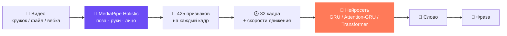

<div align="center">

<a href="https://t.me/zhestik_bot"></a>

# Жестик 🤟

### Переводчик с русского жестового языка в текст

Запиши кружок в Telegram или видео на сайте — нейросеть найдёт руки, лицо и позу<br/>
и переведёт жесты РЖЯ в текст за пару секунд.

<br/>

<a href="https://t.me/zhestik_bot"></a>

<br/><br/>


</div>

---

## ✨ Возможности

|  |  |
|---|---|
| 📹 **Кружки и видео** | Бот принимает кружки, видео и видеофайлы до 20 МБ, сайт — запись с веб-камеры и файлы до 50 МБ |
| 🧩 **Фразы, а не только слова** | Длинное видео разбивается скользящим окном, жесты складываются во фразу: *«Привет, я рад»* |
| 🎯 **Уверенность модели** | Для каждого слова — вероятность; если модель сомневается, показываются похожие варианты |
| 📚 **400 жестов** | Словарь с поиском и алфавитным указателем — в боте и на сайте |
| 🌗 **Веб-версия** | Запись с камеры в браузере, загрузка файла, озвучка перевода, светлая и тёмная тема |
| ⚡ **Работает на CPU** | Модель ~1–2 млн параметров, видеокарта нужна только для быстрого обучения |
| 🔄 **Горячая замена модели** | Бот и сайт сами подхватывают новую модель — без перезапуска |

---

## 🧠 Как это работает

Жестик смотрит не на пиксели, а на **движение скелета** — поэтому ему не важны фон, свет, одежда и внешность.



**1. Скелет.** MediaPipe Holistic — готовая замороженная сеть от Google — находит в каждом кадре 140+ точек.

**2. Признаки.** Точки нормализуются относительно плеч (неважно, где человек стоит и как далеко от камеры) и собираются в вектор из 425 чисел:

| Блок | Что описывает | Размер |
|---|---|:---:|
| 🧍 Поза | плечи, локти, запястья, голова | 75 |
| ✋ Руки относительно тела | *где* находятся кисти | 63 × 2 |
| 🤌 Форма кистей | *какая* форма: кулак, палец, «V» | 63 × 2 |
| 👄 Лицо | губы и брови — мимика несёт смысл | 96 |
| 🚩 Флаги | найдена ли левая / правая рука | 2 |

**3. Классификация.** Клип сжимается до 32 кадров, к координатам добавляются скорости, и нейросеть по последовательности движений определяет жест. Учится только она — MediaPipe используется как готовый экстрактор признаков.

**4. Фраза.** Для длинных видео окно 1.6 с скользит по записи; слово засчитывается, только если несколько окон подряд уверенно согласны.

### Архитектуры

| `--arch` | Устройство |
|---|---|
| `gru` | Linear → BiGRU (2 слоя) → среднее по времени → классификатор |
| `attn_gru` | Residual Conv1D-блоки → BiGRU → attention / mean / max pooling → MLP |
| `transformer` | Позиционное кодирование → Transformer Encoder → attention / mean pooling |

Аугментации при обучении: отражение (левша ↔ правша), обрезка по времени, поворот, масштаб, шум трекинга, «потеря» руки. Валидация — **signer-disjoint**: один человек не попадает одновременно в обучение и проверку.

---

## 📊 Результаты

Текущая модель в боте и на сайте — `gru` на **401 классе** (400 жестов + «нет жеста»).
Метрики на валидации из людей, которых модель не видела при обучении:

| Словарь | Модель | Accuracy | Macro-F1 | Balanced acc. |
|---|---|:---:|:---:|:---:|
| 400 жестов + «нет жеста» | `gru` | **56.7%** | **0.544** | **56.1%** |

Для сравнения: случайное угадывание среди 401 класса — 0.25%. В обучающей части на каждый жест приходится всего ~10 примеров.

---

## 📚 Словарь

**400 жестов** + класс «нет жеста» из открытого датасета Slovo (SberDevices).

<details>
<summary><b>Примеры слов</b></summary>

<br/>

**Приветствия:** привет · пока · добро пожаловать · с днём рождения
**Местоимения:** я · ты · мы · вы · меня · тебя · мой · твой · наш
**Вопросы:** кто · что · когда · почему · сколько
**Люди:** мать · отец · брат · сестра · друг · семья · ребёнок
**Действия:** хотеть · знать · понять · помочь · есть · пить · идти · работать · любить
**Время:** сегодня · завтра · вчера · утро · вечер · понедельник … воскресенье
**Оценки:** хорошо · плохо · очень · рад · вкусный · интересный

Полный список — в боте (кнопка «📝 Список слов»), на сайте или в `src/translator/vocab.json`.

</details>

---

## 🚀 Быстрый старт

### 1. Установка

```bash
git clone https://github.com/Vladisluv12/vibehack.git
cd vibehack
git checkout translator

python3.12 -m venv .venv
source .venv/bin/activate
pip install -r requirements-training.txt
pip install aiogram aiohttp-socks python-decouple fastapi "uvicorn[standard]" python-multipart
```

PyTorch ставится отдельно: CUDA-сборка для обучения на GPU или для CPU:

```bash
pip install torch --index-url https://download.pytorch.org/whl/cpu
```

### 2. Настройка

Создай `.env` в корне проекта:

```env
BOT_TOKEN=123456:ABC-токен-от-BotFather
TG_PROXY=socks5://127.0.0.1:12334
```

`TG_PROXY` — необязательно: SOCKS-порт VPN-клиента, если Telegram недоступен напрямую.

Модель, которую используют бот и сайт, лежит в `models/sign_gru.pt`.

### 3. Бот и сайт одной командой

```bash
bash run.sh
```

Бот начнёт отвечать в Telegram, сайт откроется на `http://localhost:8000`. Ctrl+C останавливает оба.

Или по отдельности:

```bash
python src/translator/bot.py --check
python src/translator/bot.py
python src/web/app.py
```

Камера в браузере работает только на `localhost` или по `https`.

### 4. Вебка в реальном времени и распознавание файла

```bash
python src/translator/realtime.py
python src/translator/recognizer.py path/to/video.mp4
```

---

## 🏋️ Обучение модели

<details>
<summary><b>Полный цикл: от видео до модели</b></summary>

<br/>

**1. Датасет.** Скачай Slovo и распакуй в `data/slovo/` (`annotations.csv`, `train/`, `test/`).

**2. Словарь.**

```bash
python src/translator/make_vocab.py --words-file src/translator/words_basic.txt --size 400
```

**3. Извлечение точек** — самый долгий шаг (MediaPipe работает только на CPU). Можно распределить между несколькими ПК пропорционально числу ядер:

| ПК | Ядер | Команда |
|---|:---:|---|
| 1 | 16 | `python src/translator/extract_slovo.py --shard 0,1,2,3/8 --workers 14 --max-side 640 --frame-step 2` |
| 2 | 12 | `python src/translator/extract_slovo.py --shard 4,5,6/8 --workers 10 --max-side 640 --frame-step 2` |
| 3 | 4 | `python src/translator/extract_slovo.py --shard 7/8 --workers 3 --max-side 640 --frame-step 2` |

**4. Сборка** результатов на одном ПК:

```bash
python src/translator/merge_kp.py pack
python src/translator/merge_kp.py unpack data/kp_*.zip
python src/translator/merge_kp.py check
```

**5. Обучение, подбор архитектуры и финальная оценка:**

```bash
python src/translator/train.py --arch gru --epochs 100 --patience 15 --device cuda
python src/translator/experiments.py --space configs/search-small.json --method grid --trials 12 --folds 3 --device cuda --refit
python src/translator/evaluate.py --model runs/search_<timestamp>/final/best.pt --device cuda
```

**6. Подключить новую модель** к боту и сайту:

```bash
cp runs/<папка_запуска>/best.pt models/sign_gru.pt
```

</details>

---

## 🗂️ Структура проекта

```
vibehack/
├── run.sh                       # бот + сайт одной командой
├── models/sign_gru.pt           # модель для бота и сайта
├── src/
│   ├── translator/
│   │   ├── features.py          # словарь, 425 признаков кадра, нормализация
│   │   ├── model.py             # gru · attn_gru · transformer
│   │   ├── extract_slovo.py     # видео → точки (с разделением между ПК)
│   │   ├── merge_kp.py          # сборка точек с нескольких ПК
│   │   ├── make_vocab.py        # сборка словаря → vocab.json
│   │   ├── train.py             # обучение одной конфигурации
│   │   ├── training.py          # данные, аугментации, фолды, метрики
│   │   ├── experiments.py       # перебор конфигураций с кросс-валидацией
│   │   ├── evaluate.py          # финальная проверка на test
│   │   ├── recognizer.py        # распознавание видеофайла (бот + сайт)
│   │   ├── realtime.py          # распознавание с веб-камеры
│   │   └── bot.py               # Telegram-бот
│   └── web/
│       ├── app.py               # FastAPI-бэкенд
│       └── static/index.html    # веб-интерфейс
├── configs/                     # пространства поиска гиперпараметров
├── tests/                       # unit-тесты обучения
├── data/                        # датасет и точки (в .gitignore)
└── runs/                        # результаты обучений (в .gitignore)
```

---

## 🛣️ Планы

- [x] Распознавание изолированных жестов по ключевым точкам
- [x] Telegram-бот: кружки, видео, фразы из нескольких жестов
- [x] Веб-версия с записью с камеры
- [x] Словарь на 400 жестов, распределённое извлечение признаков
- [ ] Перевод последовательности жестов в грамматичное русское предложение с помощью LLM
- [ ] Распознавание прямо в браузере
- [ ] Дообучение на собственных записях

---

## 🙏 Благодарности

- **Slovo** — открытый датасет русского жестового языка от SberDevices
- **MediaPipe** — извлечение ключевых точек тела, рук и лица
- **aiogram** и **FastAPI** — бот и веб-сервер

<div align="center">

<br/>

<a href="https://t.me/zhestik_bot"></a>

<br/><br/>

Сделано с 💜 на хакатоне «Вайбкодинг ФКН»

</div>
